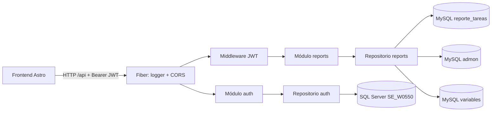
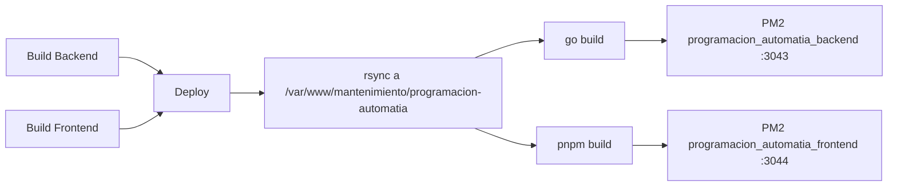

# Documentación Técnica – Backend

API REST del sistema **SAO6 – Programación Automática** de mantenimiento. Está escrita en **Go + Fiber**. Autentica empleados contra un **SQL Server** corporativo (solo lectura) y construye los reportes de tareas desde tres bases **MySQL** (reportes, administración y variables de control).

## Índice

1. [Stack](#1-stack)
2. [Arquitectura](#2-arquitectura)
3. [Estructura de carpetas](#3-estructura-de-carpetas)
4. [Principios SOLID aplicados](#4-principios-solid-aplicados)
5. [Endpoints](#5-endpoints)
6. [Modelo de datos](#6-modelo-de-datos)
7. [Autenticación](#7-autenticación)
8. [Variables de entorno](#8-variables-de-entorno)
9. [Comandos](#9-comandos)
10. [Despliegue](#10-despliegue)

## 1. Stack

| Tecnología | Uso |
|---|---|
| Go 1.25 | Lenguaje y runtime |
| Fiber v2 | Servidor HTTP, CORS y logger |
| `database/sql` | Acceso a datos |
| `go-mssqldb` | Driver de SQL Server (login) |
| `go-sql-driver/mysql` | Driver de MySQL (reportes) |
| `golang-jwt/jwt` v5 | Emisión y validación de tokens (HS256) |
| `godotenv` | Carga de `.env` |
| sqlc | Generación de código a partir de `db/queries` (SQL Server) |

## 2. Arquitectura



Cada módulo sigue las capas **handler** (HTTP) → **service** (negocio) → **repository** (datos). `reports` es la excepción: su handler llama directo al repositorio, sin capa de servicio.

## 3. Estructura de carpetas

```text
backend/
├── cmd/api/main.go            # Logs a archivo, 4 conexiones, arranque del servidor
├── sqlc.yaml                  # Configuración de sqlc (engine sqlserver)
├── db/
│   ├── migrations/            # Esquema de SE_W0550 (referencia para sqlc)
│   └── queries/auth.sql       # Consultas de login y perfil
└── internal/
    ├── config/config.go       # Lectura de variables de entorno
    ├── middleware/auth.go     # Validación del JWT Bearer
    ├── auth/                  # domain, handler, service, repository
    ├── reports/               # domain, handler, repository (consultas MySQL)
    └── platform/
        ├── db/generated/      # Código generado por sqlc
        └── server/server.go   # Rutas, CORS, logger y Listen
```

## 4. Principios SOLID aplicados

| Principio | Aplicación |
|---|---|
| **S** | Un paquete por dominio (`auth`, `reports`); handler, service y repository separados |
| **O** | Un nuevo reporte se agrega como método y ruta sin tocar los existentes |
| **L / I** | Interfaces pequeñas: `auth.Service`, `auth.Repository`, `reports.Repository` |
| **D** | `auth.Service` depende de la interfaz `Repository`, no de `*sql.DB` |

> [!NOTE]
> `reports.Handler` depende directamente de `reports.Repository`. Falta una capa de servicio donde viva la lógica de filtrado de tareas abiertas y de resolución de IDs.

## 5. Endpoints

Prefijo base: `/api`. Todas las rutas, salvo el login, exigen `Authorization: Bearer <token>`.

| Método | Ruta | Auth | Descripción |
|---|---|---|---|
| POST | `/auth/login` | No | Valida correo y contraseña, devuelve el JWT |
| GET | `/auth/get-data` | Sí | Nombre y cargo del usuario del token |
| GET | `/reports` | Sí | Reporte general de tareas |
| GET | `/reports/lubricacion` | Sí | Tareas de lubricación (motor y chasis) |
| GET | `/reports/diagnostico` | Sí | Tareas de diagnóstico |
| GET | `/reports/engrase` | Sí | Tareas de engrase |
| GET | `/reports/responsables` | Sí | Empleados con rol responsable |
| GET | `/reports/tecnicos` | Sí | Empleados con rol técnico |
| POST | `/reports/detalle-admon` | Sí | Detalle de tareas por lista de IDs |
| POST | `/reports/partes-excel` | Sí | Datos de cada parte para armar el Excel |

### Contratos

**`POST /auth/login`**

```json
// Request
{ "email": "usuario@empresa.com", "password": "<nit_del_empleado>" }

// 200
{ "message": "Login correcto", "done": true, "data": { "token": "<jwt>" } }

// 401
{ "error": "credenciales inválidas o cargo no autorizado" }
```

**`POST /reports/detalle-admon`**: body `{ "ids": ["..."] }`, devuelve `TareaAdmon[]`.

**`POST /reports/partes-excel`**: body `{ "tareas_abiertas": ["..."] }`, devuelve un objeto `{ [parte]: DatosExcelAdmon }`.

Errores: `400 { "error": "cuerpo de solicitud inválido" }`, `401 { "message", "done": false }` desde el middleware y `500 { "error": "<detalle>" }`.

## 6. Modelo de datos

### SQL Server (solo lectura)

Tabla **`SE_W0550`** (empleados). Se usa para el login y el perfil.

| Columna | Tipo | Uso |
|---|---|---|
| `f_email_contacto` | NVARCHAR(255) | Usuario (login) |
| `f_nit_empl` | NVARCHAR(100) | Contraseña (login) |
| `f_desc_cargo` | NVARCHAR(255) | Cargo; filtra quién puede entrar |
| `f_ndc`, `f_parametro` | INT | Datos auxiliares |
| `f_nombre_empl` | NVARCHAR | Nombre para el perfil |

### MySQL

| Base (variable) | Tablas consultadas |
|---|---|
| Programación (`DB_NOMBRE`) | `reporte_tareas` |
| Admon (`MYSQL_ADMON_DATABASE`) | `tareas_solicitadas_activos`, `informacion_activos`, `informacion_empleados`, `causa_basica`, `agrupador_tareas`, `zona_maquina` |
| Variables (`DB_NOMBRE_VARIABLES`) | `registro_variables`, `actualizacion_variable_control` |

### Modelos de respuesta (`reports/domain.go`)

| Modelo | Campos principales |
|---|---|
| `ReporteTarea` | `bus`, `tarea`, `estado`, `tarea_abierta_posterior`, `frecuencia_tarea_ultima`, `dato_hoy`, `taxonomia_4`, `tipo` |
| `TareaAdmon` | `id_tarea_generada`, `codigo_activo`, `clase_activo`, `referencia_inteligente`, `parte`, `nombre_dia` |
| `DatosExcelAdmon` | `parte`, `fecha_propuesta`, `prioridad`, `subproceso`, `zona_maquina`, `causa_basica`, tiempos de caracterización, desplazamiento, planeación y cierre, `frecuencia`, `politica`, `numero_novedad`, entre otros |

El repositorio carga los catálogos pequeños (empleados, zonas, causas, agrupadores) en mapas en memoria y consulta los valores de variables por lotes. Así evita `JOIN` costosos y consultas N+1.

## 7. Autenticación

1. `POST /auth/login` recibe `email` y `password`.
2. Rechaza el login si falta alguno de los dos.
3. Busca en `SE_W0550` el correo y el NIT (`password`), con `LTRIM/RTRIM`.
4. Solo permite los cargos `PROFESIONAL DE PLANEACION Y PROGRAMACION` y `ANALISTA DE MANTENIMIENTO`.
5. Emite un JWT HS256 con `email`, `cargo` y `exp` de 24 horas.
6. `AuthMiddleware` valida el esquema `Bearer`, la firma y la expiración, y guarda `user_email` en `c.Locals`.

El frontend guarda el token en `localStorage`.

## 8. Variables de entorno

| Variable | Descripción | Defecto |
|---|---|---|
| `PORT` | Puerto HTTP | `4000` (3043 en producción) |
| `JWT_SECRET` | Clave de firma del JWT | `default-secret` |
| `DB_SERVER`, `DB_USER`, `DB_PASSWORD`, `DB_DATABASE` | SQL Server | `localhost`, `sa`, vacío, `master` |
| `DB_ENCRYPT`, `DB_TRUST_CERTIFICATE` | TLS de SQL Server | `false`, `true` |
| `DB_HOST`, `DB_PORT`, `DB_USUARIO`, `DB_CONTRASENA`, `DB_NOMBRE` | MySQL de programación | `localhost`, `3306`, `root`, vacío, vacío |
| `DB_NOMBRE_VARIABLES` | Base MySQL de variables (mismo servidor que la anterior) | vacío |
| `MYSQL_ADMON_HOST`, `_PORT`, `_USER`, `_PASSWORD`, `_DATABASE` | MySQL Admon | `localhost`, `3306`, `root`, vacío, vacío |


## 9. Comandos

```bash
cd backend
go mod download
go run ./cmd/api/main.go                  # desarrollo
go build -o server ./cmd/api/main.go      # compilar
sqlc generate                             # regenerar internal/platform/db/generated
```

Los logs se escriben en `backend/backend.log`.

## 10. Despliegue

Workflow `.github/workflows/ci-cd.yml`, se dispara con `push` a `main` y corre en un runner *self-hosted* Linux.



El `rsync` excluye `.env`, `backend.log`, `node_modules` y el binario `server`. Por eso el `.env` de producción se administra a mano en el servidor.
