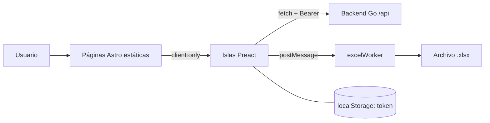

# Documentación Técnica – Frontend

Aplicación web del sistema **SAO6 – Programación Automática**. Permite iniciar sesión, consultar las tareas de mantenimiento por tipo (lubricación, diagnóstico y engrase), asignarlas a responsables y técnicos por día, y **exportar el resultado a un Excel plano**. Está hecha con **Astro** y **Preact**, y se compila como sitio estático.

## Índice

1. [Stack](#1-stack)
2. [Arquitectura](#2-arquitectura)
3. [Estructura de carpetas](#3-estructura-de-carpetas)
4. [Páginas y rutas](#4-páginas-y-rutas)
5. [Componentes](#5-componentes)
6. [Consumo de la API](#6-consumo-de-la-api)
7. [Autenticación y sesión](#7-autenticación-y-sesión)
8. [Generación del Excel](#8-generación-del-excel)
9. [Estilos y diseño](#9-estilos-y-diseño)
10. [Variables de entorno](#10-variables-de-entorno)
11. [Comandos](#11-comandos)
12. [Despliegue](#12-despliegue)
13. [Puntos de mejora y riesgos](#13-puntos-de-mejora-y-riesgos)

## 1. Stack

| Tecnología | Uso |
|---|---|
| Node.js ≥ 22.12 + pnpm | Runtime y gestor de paquetes |
| Astro 6 | Páginas, enrutado y *build* estático |
| Preact 10 (`compat: true`) | Componentes interactivos (islas) |
| TypeScript | Tipado |
| Tailwind CSS 4 (`@tailwindcss/vite`) | Estilos |
| Hugeicons | Iconos |
| `xlsx` (SheetJS) | Generación del Excel |
| `@calendarjs/ce` | Calendario |
| Astro `ClientRouter` | Transiciones entre páginas |

## 2. Arquitectura



Astro entrega el HTML estático (cabecera, pie y estructura). Toda la lógica vive en **islas Preact** con `client:only="preact"`, que se renderizan solo en el navegador. El Excel se arma en un **Web Worker** para no bloquear la interfaz.

## 3. Estructura de carpetas

```text
├── astro.config.mjs              # Preact + Tailwind (Vite)
├── public/                       # favicon e imágenes
├── assets/ArchivoPlano.xlsx      # Plantilla de referencia del Excel
└── src/
    ├── config/api.ts             # API_URL
    ├── pages/
    │   ├── index.astro           # Entrada
    │   ├── login.astro           # Inicio de sesión
    │   └── dashboard.astro       # Panel de control
    ├── components/
    │   ├── auth/                 # LoginForm, Logo
    │   ├── dashboard/            # DashboardActions, DashboardGrid, MiniCalendarPicker, UserMenu
    │   ├── tables/               # AsignacionTable, MiniTable, OperationsTable
    │   └── ui/Modal.tsx          # Modal reutilizable
    ├── workers/excelWorker.ts    # Generación del .xlsx en segundo plano
    └── styles/global.css         # Tailwind y variables de color
```

## 4. Páginas y rutas

| Ruta | Archivo | Contenido |
|---|---|---|
| `/` | `index.astro` | Punto de entrada |
| `/login` | `login.astro` | Formulario con `LoginForm` |
| `/dashboard` | `dashboard.astro` | Cabecera con `UserMenu`, `DashboardActions` y `DashboardGrid` |

## 5. Componentes

| Componente | Responsabilidad |
|---|---|
| `LoginForm` | Envía credenciales, guarda el token y redirige a `/dashboard` |
| `UserMenu` | Muestra nombre y cargo (`/auth/get-data`) y cierra sesión |
| `DashboardActions` | Barra de acciones: rango de fechas, exclusión de días, prioridades, agrupar y generar Excel |
| `DashboardGrid` | Carga lubricación (motor y chasis), diagnóstico y engrase; muestra las tarjetas por bus y gestiona el estado de las asignaciones |
| `MiniCalendarPicker` | Selección de rango de fechas |
| `AsignacionTable` | Asignación de responsable y técnico por bus; carga ambos catálogos y ofrece menú contextual |
| `MiniTable`, `OperationsTable` | Tablas de tareas con ordenamiento y grupos expandibles |
| `Modal` | Contenedor modal (`isOpen`, `onClose`, `title`, `maxWidth`) |

### Tipos principales

```ts
interface TareaData {
  bus: string;
  tarea: string;
  estado: string;                    // Vencida, Próxima, etc. (define el color)
  frecuencia_tarea_ultima?: string;
  dato_hoy?: string;
  // ...
}
```

## 6. Consumo de la API

`API_URL` sale de `PUBLIC_API_URL` y vale `http://localhost:4000/api` si no se define. Cada llamada envía `Authorization: Bearer <token>`.

| Componente | Endpoint | Uso |
|---|---|---|
| `LoginForm` | `POST /auth/login` | Obtener el JWT |
| `UserMenu` | `GET /auth/get-data` | Perfil |
| `DashboardGrid` | `GET /reports/lubricacion`, `/diagnostico`, `/engrase` | Tareas por tipo |
| `DashboardGrid` | `POST /reports/partes-excel` | Datos de cada parte para el Excel |
| `AsignacionTable` | `GET /reports/responsables`, `/tecnicos` | Catálogos de personal |
| `OperationsTable` | `GET /reports` | Reporte general |

El contrato completo de cada endpoint está en [DOCUMENTACION_BACKEND.md](DOCUMENTACION_BACKEND.md#5-endpoints).

## 7. Autenticación y sesión

1. `LoginForm` envía `{ email, password }` a `/auth/login`.
2. Si responde bien, guarda `data.token` en `localStorage` y redirige con `window.location.href`.
3. Los componentes leen `localStorage.getItem('token')` antes de cada `fetch`.
4. `UserMenu` borra el token al cerrar sesión.

## 8. Generación del Excel

1. `DashboardActions` arma las filas a partir de las asignaciones, las fechas elegidas y los datos de `partes-excel`.
2. Calcula los días de prioridad a partir del texto de `prioridad` y las fechas propuestas.
3. Crea un `Worker` (`excelWorker.ts`) y le envía `{ filas, header, columnWidths, fileName }`.
4. El worker responde con `{ success, buffer, fileName }` o `{ success: false, error }`.
5. El archivo se descarga como `ArchivoPlano_<fecha>.xlsx`, con el mismo formato que `assets/ArchivoPlano.xlsx`.

## 9. Estilos y diseño

Tailwind 4 con variables de color (`primary`, `texto-dark`, `texto-grey`) definidas en `global.css`. La tipografía es **Inter**, cargada desde Google Fonts. Los principios visuales (bordes redondeados, sombras suaves, *glassmorphism* y micro-interacciones) están en [DESING.md](../DESING.md).

## 10. Variables de entorno

| Variable | Descripción | Defecto |
|---|---|---|
| `PUBLIC_API_URL` | URL base de la API, se incrusta en el *build* | `http://localhost:4000/api` |

> [!NOTE]
> Al ser un sitio estático, `PUBLIC_API_URL` se fija al compilar. Hay que definirla antes de `pnpm build`.

## 11. Comandos

```bash
pnpm install
pnpm dev        # servidor de desarrollo
pnpm build      # genera dist/
pnpm preview    # sirve dist/ localmente
```

## 12. Despliegue

El workflow `.github/workflows/ci-cd.yml` compila con `pnpm run build` y sirve `dist/` con PM2 como `programacion_automatia_frontend` en el puerto **3044** (`pnpm dlx serve dist -l 3044`). El backend corre en el **3043**. Ver [el despliegue del backend](DOCUMENTACION_BACKEND.md#10-despliegue).

## 13. Puntos de mejora y riesgos

| Prioridad | Tema | Acción sugerida |
|---|---|---|
| Alta | Token en `localStorage` | Cookie `HttpOnly` emitida por el backend (mitiga el robo por XSS) |
| Alta | Sin guarda de ruta en `/dashboard` | Redirigir a `/login` si no hay token y ante un `401` |
| Alta | `PUBLIC_API_URL` ausente en producción cae a `localhost` | Definirla en el workflow y fallar el *build* si falta |
| Media | Componentes enormes: `DashboardGrid` (~78 KB) y `DashboardActions` (~55 KB) | Dividir en hooks (`useReportes`, `useAsignaciones`) y subcomponentes |
| Media | `fetch` repetido con el token en cada componente | Cliente único `apiFetch` en `src/config` que añada el token y trate el `401` |
| Media | Uso de `any` (p. ej. `assignments`, `AsignacionTable`) | Tipar los modelos compartidos |
| Media | Errores con `alert()` y `console.error` | Componente de notificaciones (*toast*) |
| Media | Tipos de la API duplicados a mano | Centralizar en `src/types` según `reports/domain.go` |
| Baja | `public/DSC_0010.JPG` pesa ~17 MB y `.webp` ~10 MB | Optimizar o reducir la resolución |
| Baja | Sin pruebas | Vitest para la lógica de asignación y el cálculo de fechas |
| Baja | Fuente cargada desde Google Fonts | Autoalojar con `@fontsource/inter` si la red es restringida |
| Baja | `README.md` genérico de Astro | Enlazar esta documentación |
